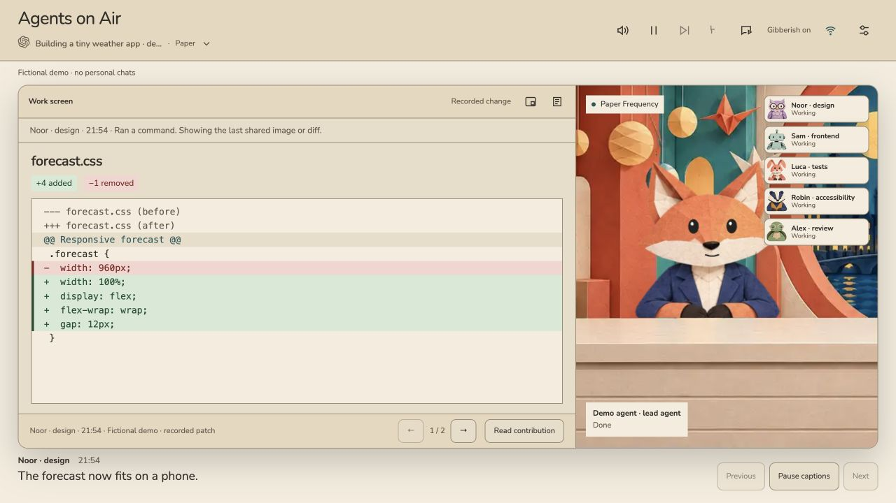
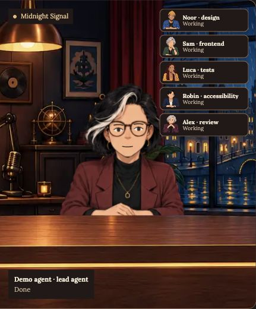
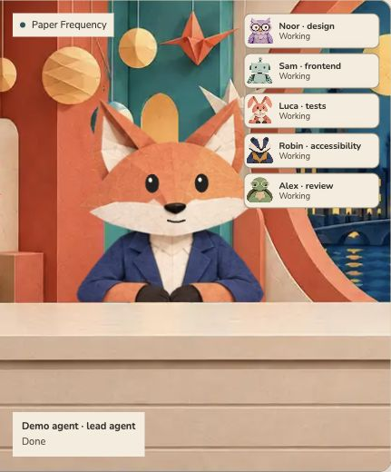
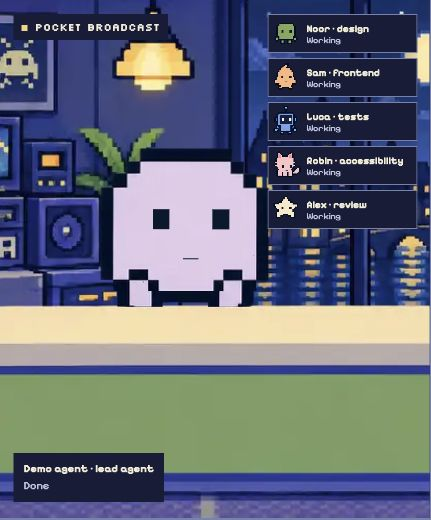

# Agents on Air

### Your agents. Your own news channel.

Put Agents on Air on your second screen while you work. Pick a local Codex or Claude Code chat and watch its agents as an animated cast, with short captions and a shared screen for recorded images and code changes. Keep coding on your main screen; glance over to follow the cast between your own tasks. You run and direct your agents in Codex or Claude Code.

[**Releases & downloads**](https://github.com/marcel-tuinstra/agents-on-air/releases) · [Getting started](#get-on-air) · [Make a channel](THEMES.md)

*The real interface with fictional chats. Your own chats supply the show.*

## A seat beside your work

You have agents building, testing and reviewing across different chats. Following them means opening tabs and reading updates between your own tasks.

Choose a chat in Agents on Air and keep its studio in view. Watch the lead presenter and supporting cast, read a few lines of captions, and see the recorded work with its author's name. Open the transcript when you want the details. You still give instructions and approve work in Codex or Claude Code.

Turn on gibberish for a little background company, or mute it and read. Leave a chat quiet for an hour and the studio lights dim. The presenter gets bored too.

## Pick your channel

| Midnight Signal | Paper Frequency | Pocket Broadcast |
| :---: | :---: | :---: |
|  |  |  |
| A warm evening show with a human anchor and measured chatter. | A papercraft fox, soft colors and friendly animal sounds. | A pixel cast with brisk beep-boop voices. |

Each channel has its own cast, set, typography and synthesized gibberish. Switch channels for the whole app. Use compact view when you want more room for other windows.

## Get on air

You need **Python 3.9+** (3.12 recommended), a browser, and local Codex or Claude Code chats. Standard viewing needs no API key or voice-model download.

1. Open [**Releases**](https://github.com/marcel-tuinstra/agents-on-air/releases) and download **`agents-on-air.zip`** under **Assets**.
2. Extract the ZIP and open the `agents-on-air` folder.
3. Start the app with the command for your platform:

| macOS / Linux | Windows |
| --- | --- |
| `python3 start_studio.py` | `py -3 start_studio.py` |

Run the command in a terminal opened in that folder. Your browser opens at **http://127.0.0.1:8878**. Choose a recent chat, then move the window to your second screen. Stop the server with Ctrl+C.

[Start options and controls](docs/usage.md) · [Build from source](docs/development.md)

## Your chats stay on your machine

The viewer refreshes saved local logs from both providers every two seconds. The cast reflects recorded contributions, rather than a live token stream or process monitor. You can browse chats active in the past 24 hours. Remote or cloud-only chats do not appear; images and diffs need a corresponding record in the source chat.

Normal viewing and gibberish run on your computer. For shorter, generated studio updates, you can configure a Codex/Claude CLI session or your own API key in Settings. That feature starts off; each update requires a request and may send agent text to your chosen provider. [Settings and data handling](docs/usage.md#custom-studio-updates).

## Build your own channel

Give your agents a different cast, set and sound. Each channel lives in a folder under `themes/`, with its artwork, colors, fonts and audio profiles. Copy a pack, edit it, then rebuild. You can remove a pack the same way.

Start with one of the three existing animation rigs. The [theme guide](THEMES.md) covers the format, artwork layout and sound parameters. Contributions are welcome; include redistribution licenses for the assets you add.

## License

[MIT](LICENSE) for the code and project-created theme materials. Bundled fonts and libraries retain their own licenses. See [asset credits and notices](THIRD_PARTY.md), including the AI-generated artwork and procedural audio.
